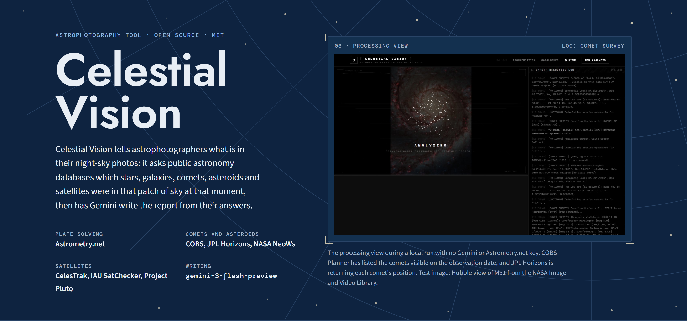
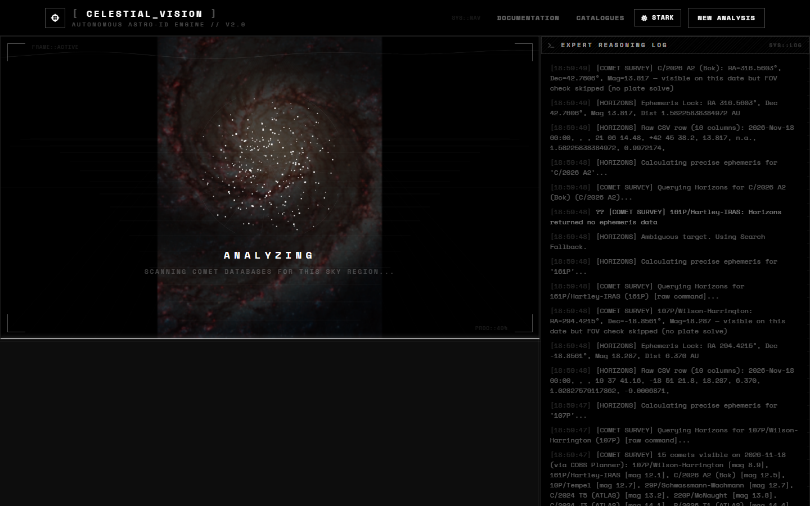
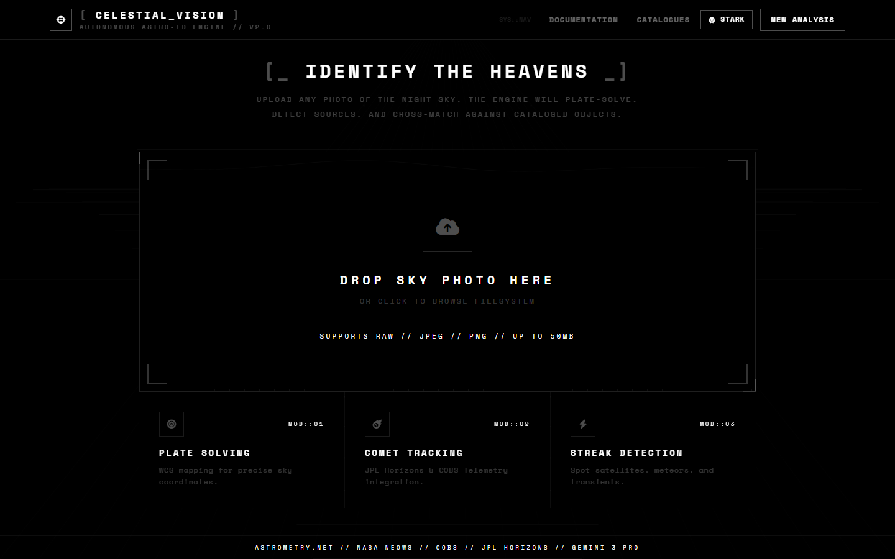
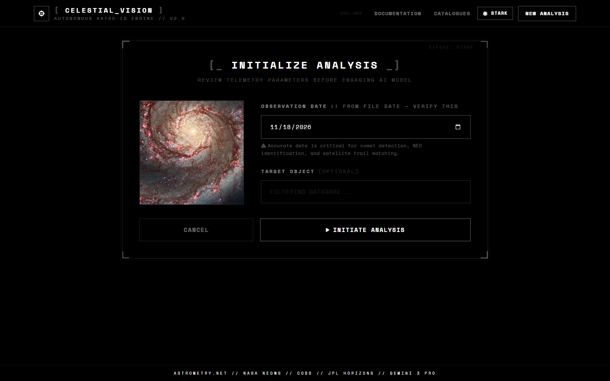
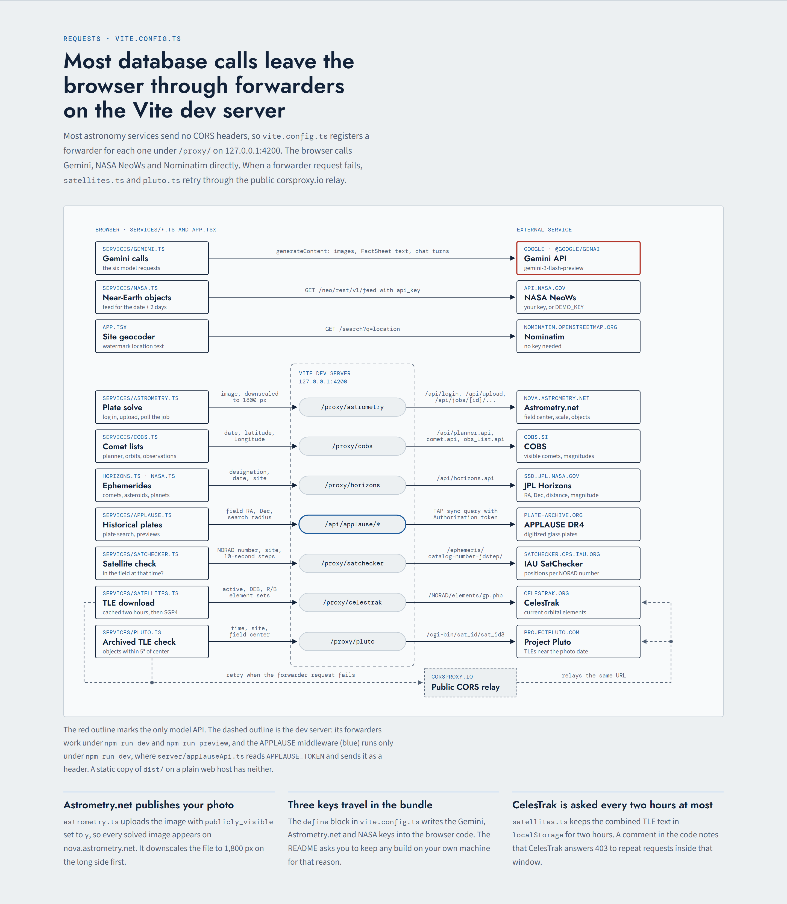
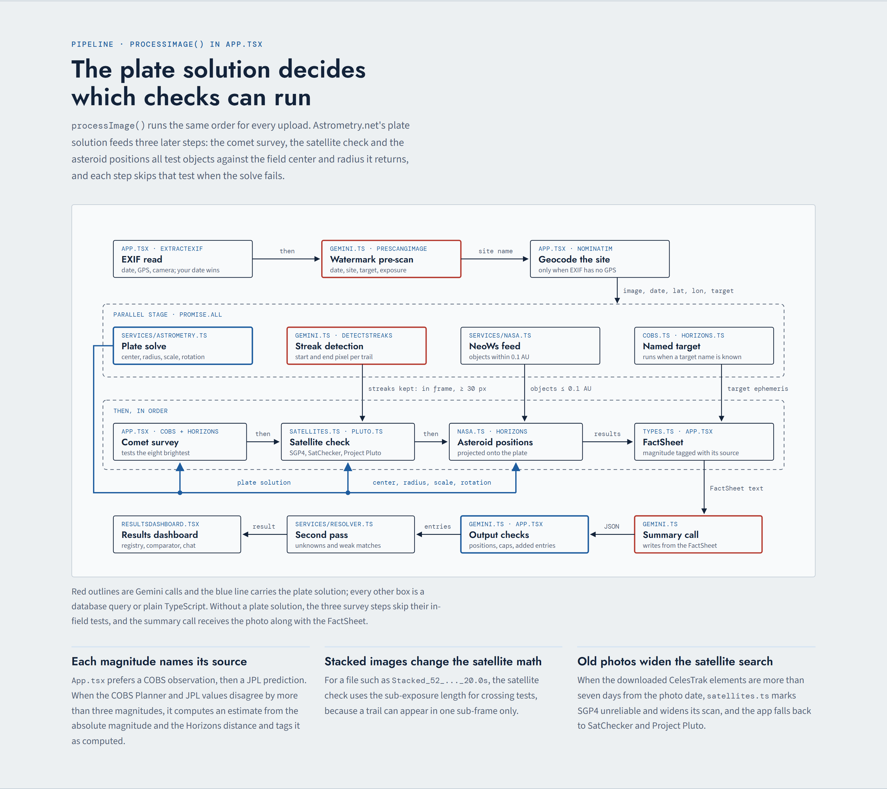
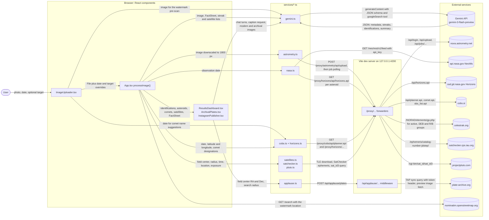
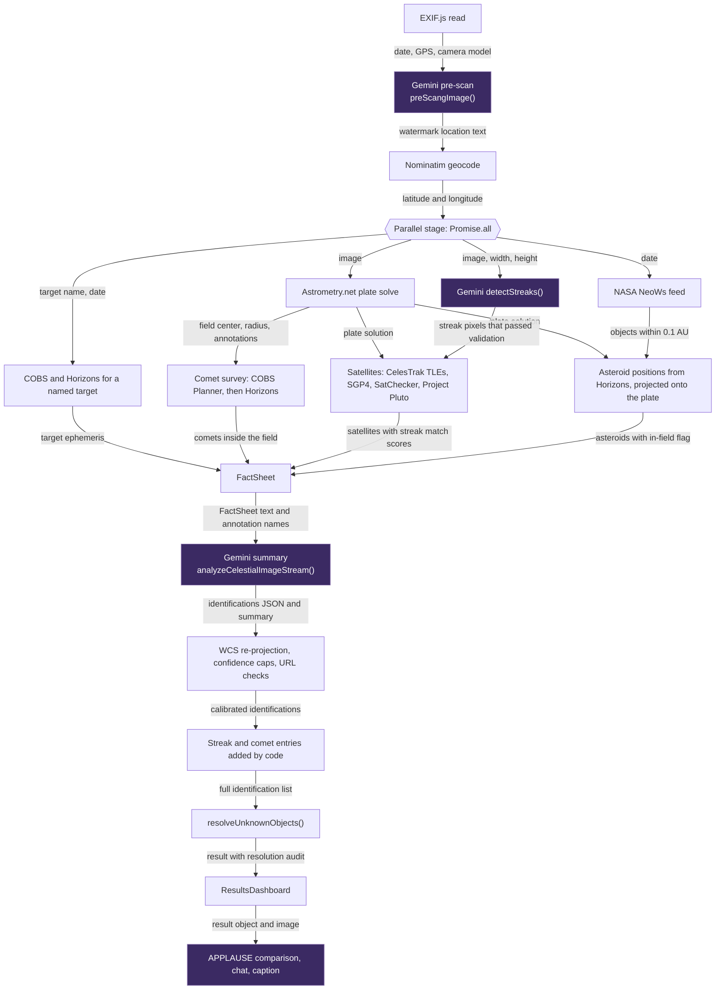

# Celestial Vision

<p align="center">
  <a href="https://nxtlupo.github.io/Celestial-Vision/">
    <picture>
      <source media="(prefers-color-scheme: dark)" srcset="docs/readme/overview-hero-dark.png">
      
    </picture>
  </a>
</p>

<p align="center"><b><a href="https://nxtlupo.github.io/Celestial-Vision/">Open the illustrated overview</a></b></p>


Celestial Vision identifies the objects in a night-sky photo by querying public astronomy databases, then has Google Gemini write the report from the answers those databases return.


You drop in a JPEG or PNG. Astrometry.net works out which patch of sky the camera saw. The app then asks NASA NeoWs, JPL Horizons, COBS, CelesTrak, IAU SatChecker and Project Pluto which asteroids, comets and satellites were in that patch at that moment, and compares the field against digitized glass plates from the APPLAUSE archive. Gemini reads watermarks, finds streaks, and writes the summary, chat answers and a social caption. Before anything reaches the screen, the code moves each object back to the position the plate solution gives it and corrects caption distances and magnitudes that disagree with the database values.

<p align="center">
  
</p>

<sub>The processing view during a local run with no Gemini or Astrometry.net key. COBS Planner has returned the comets visible on the observation date, and the app is asking JPL Horizons for each comet's position. Input image: Hubble view of M51 from the NASA Image and Video Library (GSFC_20171208_Archive_e001925).</sub>

| Upload screen | Review step before a run |
|---|---|
|  |  |

A screen recording of the app is attached to the [v0.1.0-demo release](https://github.com/NXTLupo/Celestial-Vision/releases/download/v0.1.0-demo/celestial_vision.mp4) (MP4).

## How it works, at a glance

<picture>
  <source media="(prefers-color-scheme: dark)" srcset="docs/readme/overview-flow-dark.png">
  
</picture>

<picture>
  <source media="(prefers-color-scheme: dark)" srcset="docs/readme/overview-pipeline-dark.png">
  
</picture>

<picture>
  <source media="(prefers-color-scheme: dark)" srcset="docs/readme/overview-checks-dark.png">
  
</picture>

The sections below give the full detail behind each picture.

## What the app does

| Feature | What it does | Where in the code |
|---|---|---|
| Image intake | Drag-and-drop or file picker. EXIF.js reads the date, GPS position and camera model. The review step shows where the date came from (EXIF, watermark or file date), lets you correct it, and suggests comet names from COBS for that date. | `components/ImageUploader.tsx`, `App.tsx` (`extractExif`) |
| Watermark pre-scan | Gemini reads text burned into the image (target, date, time, location, instrument, exposure) into a fixed JSON schema. A location name is geocoded with OpenStreetMap Nominatim. Seestar file names such as `Stacked_52_..._20.0s` give the exposure. | `services/gemini.ts` (`preScangImage`), `App.tsx` |
| Plate solving | Logs in to Astrometry.net, uploads the image (downscaled to 1800 px on the long side), polls the job, and returns the field center, pixel scale, field radius, orientation, catalog annotations and an annotated plot. | `services/astrometry.ts` |
| Streak detection | A separate Gemini call returns start and end pixels for every straight trail. `App.tsx` drops streaks that fall outside the frame or are shorter than 30 px. | `services/gemini.ts` (`detectStreaks`), `App.tsx` |
| Comet survey | COBS Planner lists the comets visible on the date and location. Horizons returns a position for up to eight of them, and each is checked against the plate-solved field. Packed MPC designations (`CK25T010`) are unpacked to the form Horizons accepts (`C/2025 T1`). | `App.tsx`, `services/cobs.ts`, `services/horizons.ts` |
| Near-Earth objects | The NeoWs feed for the date plus two days, filtered to objects within 0.1 AU. Horizons positions are projected onto the plate to flag objects inside the frame. | `services/nasa.ts` |
| Satellite identification | Pulls CelesTrak TLEs for active satellites, debris and rocket bodies (cached in `localStorage` for two hours), propagates them with SGP4 from satellite.js, then checks candidates with IAU SatChecker and with Project Pluto, which uses archived TLEs from the observation date. Stacked images use the sub-exposure length for crossing checks. | `services/satellites.ts`, `services/satchecker.ts`, `services/pluto.ts` |
| FactSheet and summary | `App.tsx` gathers the numbers above, each magnitude tagged with its source, into a FactSheet. Gemini writes the field summary and identification list from it. | `App.tsx`, `types.ts`, `services/gemini.ts` (`analyzeCelestialImageStream`) |
| Second-pass resolver | Picks up unknown objects, unmatched streaks and anything below 0.6 confidence. Streaks are checked against a meteor shower table, the ISS and a wider satellite tolerance; every entry with coordinates is then checked against seven planets, five bright asteroids and the visible comets through Horizons and COBS. Each entry it checks carries the list of databases it tried. | `services/resolver.ts` |
| Results dashboard | A slider compares the photo with the Astrometry.net plot. Beside it, a catalog registry lists each object with its confidence, a WCS tag when the plate solution confirmed its position, and the resolver's verdict. Panels below cover target telemetry, satellites and nearby asteroids, and a STARK toggle switches to a light theme. | `components/ResultsDashboard.tsx`, `components/Header.tsx`, `components/HudVisuals.tsx` |
| Historical plates | A dev-server middleware queries the APPLAUSE DR4 TAP service for plates around the field center and proxies their preview images. Gemini compares up to three plates with the modern image and reports new, vanished, variable, transient and moving objects. | `server/applauseApi.ts`, `services/applause.ts`, `components/ArchivalPlates.tsx` |
| Ask the Astronomer | A Gemini chat seeded with the plate solution, object list, in-field asteroids and summary, with Google Search enabled. Plate comparison results are posted into the chat as they finish. | `services/gemini.ts` (`askAstronomer`), `components/ResultsDashboard.tsx` |
| Caption and summary export | Gemini drafts an Instagram caption that cites the databases used. You can copy it, or download the images and a plain-text observation summary. | `services/gemini.ts` (`generateInstagramCaption`), `components/InstagramPublisher.tsx` |
| Processing log | Every stage writes to a live log next to the image while the run is in progress. | `components/ProcessingOverlay.tsx` |

## How a photo moves through the app

### Where each request goes

Most astronomy services do not send CORS headers, so the browser calls them through forwarders that `vite.config.ts` registers on the dev server. NASA NeoWs, Nominatim and the Gemini API are called directly from the browser.



### The order of the pipeline

`processImage()` in `App.tsx` runs these steps for every upload. The purple boxes are Gemini calls; everything else is a database query or deterministic code. The comet survey, satellite and asteroid steps run one after another, after the parallel stage finishes.



### What Gemini does and how its output is checked

The astronomy services do the identifying. Astrometry.net names the stars and deep-sky objects, COBS and Horizons place the comets, CelesTrak, SatChecker and Project Pluto place the satellites, and NeoWs with Horizons places the near-Earth asteroids. `App.tsx` copies their numbers into a FactSheet (`types.ts`) and tags each magnitude with where it came from: a COBS observation, a JPL prediction, or, when the COBS Planner and JPL predictions disagree by more than three magnitudes, an estimate computed from the absolute magnitude and the Horizons distance.

Gemini has six jobs in `services/gemini.ts`, all on the model id `gemini-3-flash-preview` through the `@google/genai` SDK. Three of them read pixels and three write text.

| Function | When it runs | What it sends | What comes back | Tools |
|---|---|---|---|---|
| `preScangImage` | Review step and the start of each run | Image | JSON with date, time, location, target, instrument, exposure, notes | None |
| `detectStreaks` | Parallel stage | Image with its width and height | JSON list of streaks with start and end pixels | None |
| `analyzeCelestialImageStream` | After the FactSheet is built | FactSheet, Astrometry.net annotation names, satellite and streak lists; the image only when plate solving failed | JSON with identifications, summary, plate solution, sources | `googleSearch`, retried without it if the JSON does not parse |
| `analyzeArchivalCrossMatch` | Dashboard, up to three APPLAUSE plates | Modern image, plate preview PNG, plate metadata | JSON with anomalies in five categories, summary, plate assessment | `googleSearch`, retried without it on failure |
| `askAstronomer` | Each chat message | Message, history, the image on the first turn, results in the system prompt | Text | `googleSearch` |
| `generateInstagramCaption` | When the caption panel opens | Image, results, plate comparison reports | Caption text | None |

The summary call has the most room to invent things, so the code constrains it at several points. Its system prompt tells the model to summarize the identifications it is given, never to identify objects from the image itself, and to quote FactSheet numbers exactly or write "unknown". When plate solving succeeds, the call carries text only. Satellites go into the prompt only if the streak detector found a trail, because stacking removes trails from the final image even when a satellite passed overhead.

After the reply arrives, `gemini.ts` overwrites the model's pixel positions with a gnomonic (tangent-plane) projection of each object's RA and Dec onto the plate solution. It caps confidence at 0.6 when there was no plate solve and at 0.5 for a streak with no catalog match. Any reference image URL that does not answer a HEAD request with an image content type within three seconds is removed.

The streak and comet entries are written by `App.tsx` directly. Each streak entry pairs the detector's pixels with the best-ranked satellite: a Project Pluto match ranks first, then a SatChecker match, then an SGP4-only estimate, and confidence follows that order. Comets that Horizons places inside the plate-solved field are added the same way.

The caption gets its own pass. `generateInstagramCaption()` finds AU distances and magnitudes in the text, rewrites any that disagree with the FactSheet (a distance off by more than half, a magnitude off by more than two), and trims the caption to Instagram's 2,200-character limit.

## Run it locally

You need Node.js (`.nvmrc` pins version 20) and npm.

```bash
git clone https://github.com/NXTLupo/Celestial-Vision.git
cd Celestial-Vision
npm install
cp .env.example .env.local     # add the keys you have; see the table below
npm run dev                    # serves http://127.0.0.1:4200
```

The dev server binds to 127.0.0.1 on port 4200 with `strictPort`, so it exits if 4200 is already taken. Pick another port with `npm run dev -- --port 4711`. Open the page, drop a JPEG or PNG on the upload box, confirm the observation date, add a target name if you know it, and press Initiate Analysis.

Without any keys, the upload screen and review step work, and a run gets partway. NASA NeoWs answers through NASA's public `DEMO_KEY`, and the COBS and Horizons comet survey runs and logs its results. Astrometry.net is skipped with a log line, and the run stops at the Gemini summary step with "Analysis engine failed." A full report needs `GEMINI_API_KEY`, and plate solving needs `ASTROMETRY_API_KEY`.

| Command | What it does |
|---|---|
| `npm run dev` | Vite dev server with the `/proxy/...` forwarders and the APPLAUSE middleware |
| `npm run build` | Production bundle in `dist/` |
| `npm run preview` | Serves `dist/` on 127.0.0.1 (Vite's preview port, 4173, unless you pass `--port`); the forwarders work, the APPLAUSE routes do not |
| `npm run typecheck` | `tsc --noEmit` |
| `npm run lint` | ESLint 9 with `typescript-eslint` and the React plugins |
| `npm run format` | Prettier over `ts`, `tsx`, `json`, `html` and `css` files |

## Keys and settings

All settings live in `.env.local`, which `.gitignore` excludes. `.env.example` lists them with empty values.

| Variable | Required? | What it is for | Where to get it |
|---|---|---|---|
| `GEMINI_API_KEY` | Yes, for a finished report | Every Gemini call. `vite.config.ts` exposes it to the browser as `process.env.API_KEY`. | [Google AI Studio](https://aistudio.google.com/app/apikey) |
| `ASTROMETRY_API_KEY` | Needed for plate solving | Astrometry.net login. Without it the app skips every check that needs the field position: satellites, in-field comets and asteroids, and the APPLAUSE plates. | [nova.astrometry.net](https://nova.astrometry.net/api_help) |
| `APPLAUSE_TOKEN` | Optional | Read by the dev-server middleware in `server/applauseApi.ts` for plate search and preview images. | [plate-archive.org](https://www.plate-archive.org/) |
| `NASA_API_KEY` | Optional | NeoWs requests. Falls back to `DEMO_KEY`, which has lower rate limits. | [api.nasa.gov](https://api.nasa.gov/) |

Two details in `vite.config.ts` matter here. Its `define` block writes the Gemini, Astrometry.net and NASA keys into the browser bundle, so a build should stay on your own machine (see [SECURITY.md](SECURITY.md)). It also calls `loadEnv(mode, '.', '')` with an empty prefix, which reads variables from your shell as well, and a shell variable with the same name overrides `.env.local`. To change the model, edit `MODEL` on line 9 of `services/gemini.ts`.

## Who it is for

- Smart-telescope owners who want to know what else is in a frame. The pre-scan prompt is written for the watermarks that Seestar, Dwarf, Unistellar and Vaonis apps print on exported images.
- Observers who caught a streak and want a satellite name with the evidence behind it: an SGP4 estimate, a SatChecker confirmation, or a Project Pluto match from archived TLEs.
- Astrophotographers who post their images and want a caption that names the databases used.
- Developers who want a working example of an LLM that writes from database results, with the checks in plain TypeScript. The processing log lists what each service returned, so a number in the report can be traced back to its source.

## Where the code lives

```
Celestial-Vision/
├── App.tsx                     pipeline (processImage), FactSheet, streak and comet injection
├── index.html                  Tailwind CDN, Font Awesome, EXIF.js, HUD styles
├── index.tsx                   React entry point
├── types.ts                    Identification, PlateSolveMetadata, FactSheet and other shared types
├── vite.config.ts              dev server, /proxy forwarders, key injection
├── components/
│   ├── ImageUploader.tsx       drop zone and review step
│   ├── ProcessingOverlay.tsx   live log and progress bar
│   ├── ResultsDashboard.tsx    comparator, catalog registry, telemetry panels, chat
│   ├── ArchivalPlates.tsx      APPLAUSE search and plate comparison
│   ├── InstagramPublisher.tsx  caption, copy, image and summary download
│   ├── Header.tsx              navigation and STARK theme toggle
│   └── HudVisuals.tsx          canvas and SVG HUD graphics, lightbox
├── services/
│   ├── gemini.ts               the six Gemini calls, WCS projection, confidence rules
│   ├── astrometry.ts           Astrometry.net login, upload, polling, annotations
│   ├── nasa.ts                 NeoWs feed and asteroid positions from Horizons
│   ├── horizons.ts             JPL Horizons ephemeris queries
│   ├── cobs.ts                 COBS comet, observation and planner queries, MPC unpacking
│   ├── satellites.ts           CelesTrak TLEs, SGP4 propagation, streak matching
│   ├── satchecker.ts           IAU SatChecker verification and search
│   ├── pluto.ts                Project Pluto sat_id query and parser
│   ├── resolver.ts             second pass over unresolved objects
│   └── applause.ts             browser client for the APPLAUSE middleware
├── server/
│   └── applauseApi.ts          Vite middleware: APPLAUSE TAP query and preview proxy
├── utils/
│   ├── catalogMatch.ts         catalog ID matching ("M 51" matches "Messier 51", "NGC 1" does not match "NGC 11")
│   └── vectorMap.ts            canvas annotation renderer, not called by the current UI
├── docs/readme/                screenshots used on this page
├── ARCHITECTURE.md             pipeline design notes
└── SECURITY.md                 key handling and the data each service receives
```

## Known limits

- The app is built for local use. Keys end up in the browser bundle, and the dev server listens only on 127.0.0.1.
- The `/proxy/...` forwarders exist only under `npm run dev` and `npm run preview`, and the APPLAUSE routes only under `npm run dev`. A static copy of `dist/` on a plain web host cannot reach those services.
- Astrometry.net uploads are sent with `publicly_visible: 'y'` (`services/astrometry.ts`), so solved images appear on nova.astrometry.net.
- A run cannot finish without Gemini. If the summary call fails, `App.tsx` stops with "Analysis engine failed."
- Streak detection and the plate comparison come from a vision model. Treat their results as candidates to check by hand.
- SGP4 positions drift when the CelesTrak TLE epoch is more than seven days from the observation date. `services/satellites.ts` marks those results unreliable, and the app falls back to SatChecker and Project Pluto.
- Direct posting to Instagram is switched off. The Publish to Instagram button only shows a message, so the caption has to be copied and posted by hand.
- Some UI labels read "Gemini 3 Pro"; the calls use the model in `MODEL` (`gemini-3-flash-preview`).
- There are no automated tests yet, and `npm run lint` reports nine `prefer-const` and `no-useless-escape` errors, so the lint step in `.github/workflows/ci.yml` fails until they are fixed.

## Data sources and credits

| Source | Operator | Used for |
|---|---|---|
| [Astrometry.net](https://nova.astrometry.net) | Lang, Hogg, Mierle, Blanton and Roweis | Plate solving and catalog annotations |
| [NASA NeoWs](https://api.nasa.gov) | NASA JPL / CNEOS | Near-Earth objects close to Earth on the date |
| [JPL Horizons](https://ssd.jpl.nasa.gov/horizons/) | NASA JPL Solar System Dynamics | Ephemerides for comets, asteroids and planets |
| [COBS](https://cobs.si) | Crni Vrh Observatory | Comet visibility planner and observed magnitudes |
| [CelesTrak](https://celestrak.org) | T.S. Kelso | Satellite TLEs |
| [satellite.js](https://github.com/shashwatak/satellite-js) | open source | SGP4 propagation in the browser |
| [IAU CPS SatChecker](https://satchecker.cps.iau.org) | IAU Centre for the Protection of Dark and Quiet Skies | Satellite position checks |
| [Project Pluto sat_code](https://projectpluto.com/sat_id.htm) | Bill Gray | Satellite identification with archived TLEs |
| [APPLAUSE](https://www.plate-archive.org) | Leibniz Institute for Astrophysics Potsdam and partners | Digitized historical photographic plates |
| [Nominatim](https://nominatim.openstreetmap.org) | OpenStreetMap Foundation | Geocoding watermark locations |
| [Gemini API](https://ai.google.dev/) | Google | Image reading and text generation |

If you use the results in published work, cite these services directly.

<details>
<summary>Citations</summary>

- Lang, D., Hogg, D.W., Mierle, K., Blanton, M., and Roweis, S. (2010). "Astrometry.net: Blind Astrometric Calibration of Arbitrary Astronomical Images." *The Astronomical Journal*, 139(5), 1782-1800. [doi:10.1088/0004-6256/139/5/1782](https://doi.org/10.1088/0004-6256/139/5/1782)
- Giorgini, J.D., et al. (1996). "JPL's On-Line Solar System Data Service." *Bulletin of the American Astronomical Society*, 28(3), 1158.
- Vallado, D., Crawford, P., Hujsak, R., and Kelso, T.S. (2006). "Revisiting Spacetrack Report #3." *AIAA/AAS Astrodynamics Specialist Conference*.
- Gray, B. "sat_code." https://github.com/Bill-Gray/sat_code
- Tuvikene, T., Edelmann, H., Groote, D., Enke, H., and Dick, W.R. (2014). "APPLAUSE: Archives of Photographic Plates for Astronomical USE." *Acta Polytechnica CTU Proceedings*, 2(2), 137-140. [doi:10.14311/APP.2014.02.0137](https://doi.org/10.14311/APP.2014.02.0137)
- Zakrajsek, J. and Mikuz, H. "COBS: Comet OBServation database." API documentation: https://cobs.si/help/cobs_api/
- Map data from OpenStreetMap contributors, licensed under the ODbL: https://www.openstreetmap.org/copyright

</details>

## License

MIT. See [LICENSE](LICENSE).
